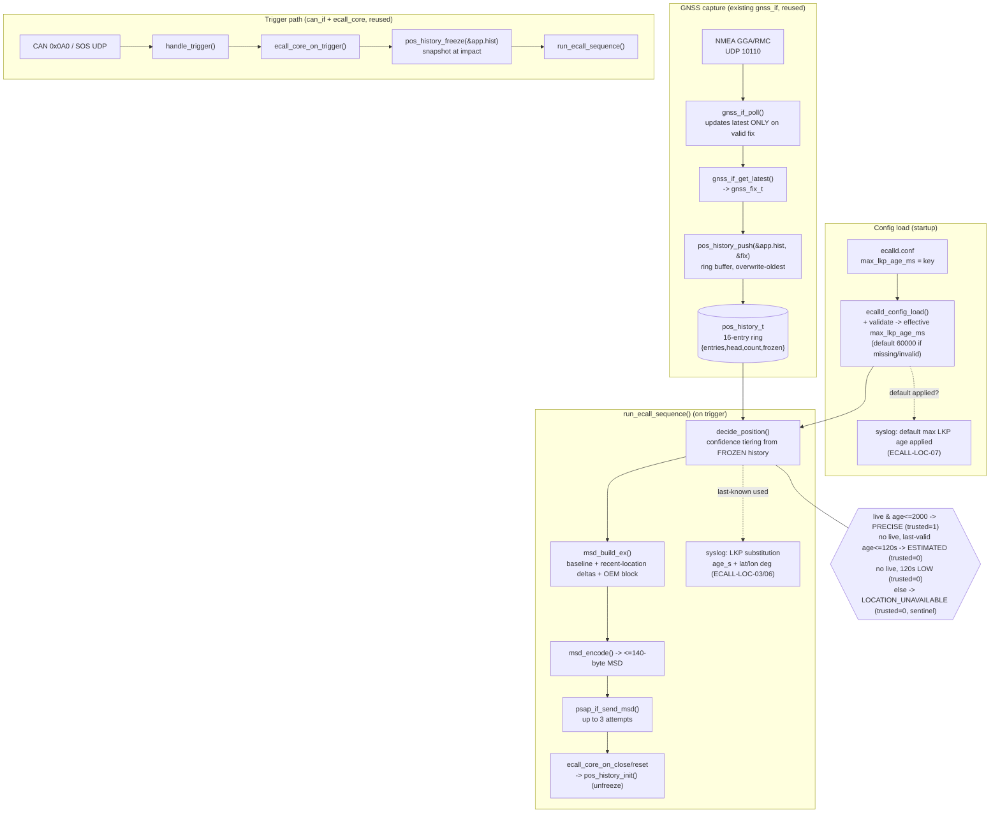

# Design Document

## Overview

This feature adds a **bounded, clearly-marked GNSS-loss fallback** to the eCall
TCU onboard software, extending the existing **v1.0 baseline** without replacing
it. In the baseline, the TCU uses live GNSS only: when no fresh fix (at most
`MSD_MAX_FIX_AGE_MS = 2000` ms old) is available, the MSD position is emitted as
`NOT_AVAILABLE` (`0x7FFFFFFF` milliarcseconds). Field analysis (9 of 40 synthetic
events, all severe rollover / tunnel-exit crashes) shows the live fix is
frequently lost at the trigger instant even though a valid fix existed 5–60 s
earlier, so the PSAP receives a voice call with no position.

The design closes this **specification gap** (not a defect — the baseline
behaves exactly as specified by `ECALL-05` / `ECALL-08`) by introducing:

1. A new **position-history ring buffer** module (`ap/libs/pos_history`) that
   records a bounded trail of valid GNSS fixes (breadcrumbs) and is **frozen at
   the crash trigger** so the snapshot used to assemble the MSD is immutable.
2. A **confidence-tiered position decision** (PRECISE / ESTIMATED / LOW /
   LOCATION_UNAVAILABLE) that reuses the most recent valid fix — with the
   **position-trusted flag cleared** — and derives a dead-reckoned impact
   position plus a search radius when no live fix exists.
3. A **backward-compatible MSD extension**: the 44-byte baseline region is kept
   byte-for-byte; compact recent-location deltas and a self-describing OEM
   additional-data block are **appended** after it, staying within the 140-byte
   cap.

The approach **extends the existing architecture; it does not replace it.** The
baseline modules — `gnss_if`, `can_if`, `ecall_core`, `msd`, `psap_if` — are all
reused. The new logic is concentrated in one new library (`pos_history`), one
extended encoder (`msd`), and a handful of wiring changes in the daemon
(`ecalld.c`) and config (`ecalld_config.c`). See `docs/ecall_spec.md`,
`docs/msd_layout.md`, and `docs/traceability.md` for the baseline this extends.

### Scope (restated)

- **In scope:** the TCU onboard software only — a bounded, clearly-marked
  GNSS-loss fallback for the MSD position, plus the recent-location trail and
  OEM additional-data block.
- **112 regulated eCall flow:** UNCHANGED. This feature does not alter the
  regulated emergency-call flow.
- **Offboard console:** UNCHANGED behaviorally. The console only displays data;
  there are no behavioral changes offboard.
- **Coexistence with baseline `ECALL-05` / `ECALL-08`:** a live fix at most
  `MSD_MAX_FIX_AGE_MS` (2000 ms) old is still **preferred**; absence of any
  usable position is still signalled explicitly as `NOT_AVAILABLE`
  (`0x7FFFFFFF` milliarcseconds for both lat and lon); empty or `0,0`
  coordinates are **never** transmitted; the position-trusted flag is MSD
  `flags` **bit1** (`FLAG_POS_TRUSTED = 0x02`) and is set **only** for a live
  (PRECISE) fix.
- **Hard constraint:** ALL v1 tests MUST keep passing — `test_can`,
  `test_core`, `test_gnss`, `test_msd`, `test_psap`. The baseline MSD byte
  layout (offsets 0..43) is unchanged; `msd_fill_position()` keeps its v1
  signature and behavior; new capability is additive.

## Architecture

Breadcrumbs are captured continuously on the existing GNSS path, snapshotted at
the trigger, and consumed by the confidence decision that feeds the extended MSD
encoder. All baseline modules are reused unchanged in their public contracts;
`pos_history` is the only new module, and `msd` gains appended fields.



Modules touched:

| Module | File(s) | Reuse / change |
|--------|---------|----------------|
| **pos_history** (NEW) | `ap/libs/pos_history/pos_history.{h,c}` | New 16-entry ring buffer of `gnss_fix_t`; push / freeze / latest / last_valid / count. `ECALL-LOC-09`, breadcrumbs |
| GNSS | `ap/libs/gnss_if/gnss_if.{h,c}` | **Reused unchanged.** `gnss_if_poll`/`gnss_if_get_latest` feed `pos_history_push`. No storage change. `ECALL-LOC-09` |
| CAN | `ap/libs/can_if/can_if.{h,c}` | **Reused unchanged.** Trigger source only. |
| Core FSM | `ap/libs/ecall_core/ecall_core.{h,c}` | **Reused unchanged.** Trigger/close hooks drive freeze/unfreeze. `ECALL-LOC-09` |
| MSD encoder | `ap/libs/msd/msd.{h,c}` | `msd_fill_position()` **unchanged** (v1 tests). New `msd_build_ex()` + appended recent-location deltas and OEM block; confidence enum. `ECALL-LOC-01..05, -08` |
| PSAP | `ap/libs/psap_if/psap_if.{h,c}` | **Reused unchanged.** Sends the extended MSD (still <=140 B). `ECALL-LOC-06` transport |
| Daemon | `ap/services/ecalld/ecalld.c` | Add `pos_history_t` to `app_t`; push on poll; freeze on trigger; decide confidence; emit substitution/default syslog. `ECALL-LOC-03, -06, -07, -09` |
| Config | `ap/services/ecalld/ecalld_config.{h,c}` | New key `max_lkp_age_ms`, default + range validation. `ECALL-LOC-07` |

## Components and Interfaces

### 1. Position history — `ap/libs/pos_history/pos_history.{h,c}` (NEW) — ECALL-LOC-09, breadcrumbs

A fixed-capacity ring buffer of valid GNSS fixes. No dynamic allocation: a
fixed `gnss_fix_t` array lives inside `pos_history_t`, which lives inside the
long-lived static `app_t`. MISRA C:2012 style: every function returns
`ecall_status_t`; callers check it.

```c
/* pos_history.h */
#ifndef POS_HISTORY_H
#define POS_HISTORY_H

#include "ecall_status.h"
#include "gnss_if.h"     /* gnss_fix_t */

#define POS_HISTORY_CAPACITY   (16u)   /* ring capacity (breadcrumbs)       */

/*
 * Ring buffer of recent valid GNSS fixes.
 *
 *  entries[] : fixed storage, no heap.
 *  head      : index where the NEXT push will write (0..CAPACITY-1).
 *  count     : number of valid stored entries (0..CAPACITY); saturates at
 *              CAPACITY once the ring has wrapped (overwrite-oldest).
 *  frozen    : when true the buffer is a stable snapshot; pushes are rejected
 *              so the trigger-time trail cannot be mutated mid-session.
 *
 * Logical ordering: the most-recent entry is at
 *   (head - 1 + CAPACITY) % CAPACITY; the oldest retained entry is at
 *   (head - count + CAPACITY) % CAPACITY.
 */
typedef struct
{
    gnss_fix_t entries[POS_HISTORY_CAPACITY];
    uint8_t    head;
    uint8_t    count;
    bool       frozen;
} pos_history_t;

/* Initialise (clears buffer, count=0, head=0, frozen=false). Also the
 * unfreeze/reset entry point used on session close. */
ecall_status_t pos_history_init(pos_history_t *h);

/*
 * Append a fix. Overwrites the oldest entry when the ring is full
 * (count stays at CAPACITY). Intended for valid fixes only (the daemon pushes
 * gnss_if_get_latest() output, which gnss_if updates only on a valid parse).
 *   h==NULL or fix==NULL -> ECALL_ERR_PARAM
 *   h->frozen            -> ECALL_ERR_STATE  (snapshot is immutable)
 *   otherwise            -> ECALL_OK
 */
ecall_status_t pos_history_push(pos_history_t *h, const gnss_fix_t *fix);

/*
 * Freeze the buffer so later pushes are rejected (stable trigger snapshot).
 *   h==NULL      -> ECALL_ERR_PARAM
 *   already frozen -> ECALL_ERR_STATE  (re-freeze is an error; see D-E)
 *   otherwise    -> ECALL_OK (sets frozen=true)
 */
ecall_status_t pos_history_freeze(pos_history_t *h);

/*
 * Copy out the most-recent entry (regardless of validity flag).
 *   h==NULL or out==NULL -> ECALL_ERR_PARAM
 *   count==0             -> ECALL_ERR_NODATA
 *   otherwise            -> ECALL_OK
 */
ecall_status_t pos_history_get_latest(const pos_history_t *h, gnss_fix_t *out);

/*
 * Copy out the most-recent entry whose valid==true, scanning newest->oldest.
 *   h==NULL or out==NULL -> ECALL_ERR_PARAM
 *   no valid entry       -> ECALL_ERR_NODATA
 *   otherwise            -> ECALL_OK
 */
ecall_status_t pos_history_last_valid(const pos_history_t *h, gnss_fix_t *out);

/*
 * Report the number of retained breadcrumbs (0..CAPACITY).
 *   h==NULL or out_count==NULL -> ECALL_ERR_PARAM
 *   otherwise                  -> ECALL_OK
 */
ecall_status_t pos_history_count(const pos_history_t *h, uint8_t *out_count);

#endif /* POS_HISTORY_H */
```

**Semantics notes.** `pos_history_push` writes at `head`, advances
`head = (head + 1) % CAPACITY`, and increments `count` only while
`count < CAPACITY` (so `count` saturates and the write silently overwrites the
oldest slot — the ring never reports `ECALL_ERR_OVERFLOW`, overwrite is normal
operation). `pos_history_last_valid` exists because, although `gnss_if` only
hands valid fixes to the daemon, the module is defensive and some entries could
be zero-initialized before first use; scanning for `valid==true` guarantees a
genuine fix. The baseline `gnss_fix_t` is reused directly; no new per-entry
metadata is required (its `rx_mono_ms` already carries the age basis).

### 2. MSD encoder — `ap/libs/msd/msd.{h,c}` — ECALL-LOC-01, -02, -04, -05, -08

**Baseline preserved.** `msd_fill_position()` keeps its exact v1 signature and
two-way behavior, and `msd_encode()` keeps writing the baseline 44-byte region
at the documented offsets. `test_msd` (`test_ECALL_MSD_01..08`) therefore keeps
passing: those tests only read offsets 0..43 and assert `len <= 140`, which the
appended region respects.

**New additive API.** A richer builder assembles the extended record from a
frozen-history decision. It fills the baseline `msd_input_t` plus a new
extension sub-structure, and a single `msd_encode()` emits baseline bytes
followed by the appended blocks.

```c
/* msd.h additions */

/* Low-confidence age split: ESTIMATED when last-fix age <= this, else LOW. */
#define MSD_LKP_LOW_CONF_AGE_MS   (120000u)   /* 120 s (ECALL-LOC, confidence) */

/* Built-in default effective max last-known-position age. */
#define MSD_DEFAULT_MAX_LKP_AGE_MS (60000u)   /* ECALL-LOC-07 */

/* Max breadcrumbs encoded in the recent-location block (byte-budget bounded). */
#define MSD_RECENT_MAX            (8u)

typedef enum
{
    MSD_CONF_PRECISE              = 0, /* live fix <=2 s, position_trusted=1   */
    MSD_CONF_ESTIMATED           = 1, /* last valid fix, age<=120 s, trusted=0 */
    MSD_CONF_LOW                 = 2, /* last valid fix, 120 s<age<=max, t=0    */
    MSD_CONF_LOCATION_UNAVAILABLE = 3 /* no usable fix, sentinel, trusted=0     */
} msd_confidence_t;

/* One breadcrumb as a signed delta (milliarcseconds) from the primary pos. */
typedef struct
{
    int16_t lat_delta_mas;   /* clamped into int16 range on encode           */
    int16_t lon_delta_mas;
} msd_recent_delta_t;

/* Appended OEM additional-data block (self-describing TLV). */
typedef struct
{
    uint16_t last_fix_age_s;      /* 0..86400, clamped                       */
    uint8_t  confidence;          /* msd_confidence_t                        */
    int32_t  dr_lat_mas;          /* dead-reckoned impact position           */
    int32_t  dr_lon_mas;          /* (== primary when DR not applied)        */
    uint16_t search_radius_m;     /* estimated search radius, meters, clamped */
    uint8_t  breadcrumb_count;    /* number of deltas actually encoded (0..8) */
} msd_oem_block_t;

/* Extension payload the builder assembles alongside msd_input_t. */
typedef struct
{
    uint8_t            recent_count;                 /* 0..MSD_RECENT_MAX    */
    msd_recent_delta_t recent[MSD_RECENT_MAX];
    msd_oem_block_t    oem;
} msd_ext_t;

/*
 * Build an extended MSD from a confidence decision. Populates base (baseline
 * fields incl. lat/lon/position_trusted) and ext (deltas + OEM block). The
 * primary lat/lon follow the confidence tier:
 *   PRECISE                -> live fix,       position_trusted = true
 *   ESTIMATED / LOW        -> last valid fix, position_trusted = false
 *   LOCATION_UNAVAILABLE   -> 0x7FFFFFFF sentinel, position_trusted = false
 * Deltas are each recent breadcrumb minus the primary coordinate, clamped to
 * int16; oem.breadcrumb_count == ext->recent_count by construction.
 */
ecall_status_t msd_build_ex(msd_input_t         *base,
                            msd_ext_t           *ext,
                            msd_confidence_t     conf,
                            const gnss_fix_t    *primary,     /* NULL if none */
                            const gnss_fix_t    *recent,      /* newest..older */
                            uint8_t              recent_n,
                            uint64_t             last_fix_age_ms,
                            uint16_t             search_radius_m,
                            uint16_t             direction_deg);

/* Encode base + ext into out[]; big-endian; total guaranteed <= MSD_MAX_BYTES
 * or ECALL_ERR_OVERFLOW. ext == NULL encodes the baseline 44-byte record only
 * (v1-compatible path). */
ecall_status_t msd_encode_ex(const msd_input_t *base,
                             const msd_ext_t   *ext,
                             uint8_t           *out,
                             size_t             out_cap,
                             size_t            *out_len);
```

`msd_encode()` (baseline) is retained and is equivalent to `msd_encode_ex(base,
NULL, ...)`. The confidence→flag rule is enforced in `msd_build_ex`:
`base->position_trusted = (conf == MSD_CONF_PRECISE)` — never set for
ESTIMATED / LOW / LOCATION_UNAVAILABLE (ECALL-LOC-02, -08.4).

### 3. Daemon — `ap/services/ecalld/ecalld.c` — ECALL-LOC-03, -06, -07, -09

`app_t` gains one field: `pos_history_t hist;` (static storage, no heap). Three
wiring points, all on existing seams:

**(a) Capture breadcrumbs on the GNSS branch.** The loop already calls
`gnss_if_poll(&app.gnss)` on the GNSS fd. After a successful poll, read the
latest and push it:

```c
if (efd == gfd)
{
    if (gnss_if_poll(&app.gnss) == ECALL_OK)
    {
        gnss_fix_t f;
        if (gnss_if_get_latest(&app.gnss, &f) == ECALL_OK)
        {
            (void)pos_history_push(&app.hist, &f); /* ERR_STATE if frozen -> ignore */
        }
    }
}
```

Because `gnss_if_poll` updates `latest` only on a valid parse, only valid fixes
reach the ring (ECALL-LOC-09.2).

**(b) Freeze at the trigger.** `handle_trigger()` freezes the history right
after a successful `ecall_core_on_trigger()`, before `run_ecall_sequence()`
assembles the MSD, so the trail is snapshotted at impact (ECALL-LOC-09.1):

```c
st = ecall_core_on_trigger(&app->core, trig);
if (st == ECALL_ERR_STATE) { /* duplicate: history already frozen */ return ECALL_OK; }
if (st != ECALL_OK)         { return st; }
(void)pos_history_freeze(&app->hist);      /* stable snapshot (ECALL-LOC-09.1) */
return run_ecall_sequence(app, trig);
```

**(c) Decide confidence from the frozen history, then unfreeze on close.**
`run_ecall_sequence` no longer reads live GNSS for position; it uses the frozen
ring. It computes the live-vs-last decision, builds the extended MSD, logs the
substitution, sends, advances the FSM, and re-initializes the history at the end
of the close/reset path so the next session starts clean (unfreeze,
ECALL-LOC-09 session boundary):

```c
msd_confidence_t conf;
gnss_fix_t       primary;
gnss_fix_t       recent[MSD_RECENT_MAX];
uint8_t          recent_n = 0u;
uint64_t         age_ms   = 0u;
bool             used_lkp = false;

conf = decide_position(&app->hist, now_ms, app->cfg.max_lkp_age_ms,
                       &primary, recent, &recent_n, &age_ms, &used_lkp);

(void)msd_build_ex(&in, &ext, conf,
                   (conf == MSD_CONF_LOCATION_UNAVAILABLE) ? NULL : &primary,
                   recent, recent_n, age_ms,
                   search_radius_from_age(age_ms, primary.speed_knots),
                   (uint16_t)primary.course_deg);

/* ... msd_encode_ex, syslog summary, psap_if_send_msd ... */

if (used_lkp)
{
    uint64_t age_s = (age_ms + 500u) / 1000u;
    if (age_s > 86400u) { age_s = 86400u; }
    log_lkp_substitution(age_s, primary.lat_deg, primary.lon_deg); /* retry 3x */
}

/* ... FSM advance ... */
(void)ecall_core_on_close(&app->core);
(void)ecall_core_reset(&app->core);
(void)pos_history_init(&app->hist);        /* unfreeze for next session */
```

`decide_position()` is a small daemon-local helper encoding the tiering table
(§ Confidence / position decision). The existing summary line is retained
(`position_trusted=%d` distinguishes a live fix from a fallback on the wire).

**Substitution + fix-age logging** (ECALL-LOC-03, -06) is emitted *before* MSD
transmission, within the same synchronous step (well under 1 s). Age is whole
seconds, rounded to nearest, clamped to 86400 s; coordinates are decimal degrees
with >= 5 decimal places; it goes to syslog, **not** the MSD byte stream (the
OEM block carries the age in seconds for the PSAP; see Data Models / D-B).

### 4. Config — `ap/services/ecalld/ecalld_config.{h,c}` — ECALL-LOC-07

Add one flat field and one key, following the existing `cfg_u32` / `strcmp`
dispatch. Validation per ECALL-LOC-07: default **60000 ms**; accepted range
**2000..600000 ms inclusive**; missing / non-numeric / zero / out-of-range →
reject and apply the default, emitting a syslog event.

```c
/* ecalld_config.h */
#define ECALLD_MAX_LKP_AGE_DEFAULT_MS  (60000u)   /* ECALL-LOC-07.2/.3 */
#define ECALLD_MAX_LKP_AGE_MIN_MS      (2000u)    /* ECALL-LOC-07.3    */
#define ECALLD_MAX_LKP_AGE_MAX_MS      (600000u)  /* ECALL-LOC-07.3    */

typedef struct
{
    /* ... existing fields unchanged ... */
    uint32_t max_lkp_age_ms;    /* effective max last-known-position age     */
    bool     lkp_age_defaulted; /* true when default was applied (for log)   */
} ecalld_config_t;
```

- `ecalld_config_defaults()` sets `max_lkp_age_ms = ECALLD_MAX_LKP_AGE_DEFAULT_MS`
  and `lkp_age_defaulted = true` (defaults applied first).
- `ecalld_config_parse_line()` adds a `max_lkp_age_ms` branch. Because `cfg_u32`
  returns 0 for both "0" and non-numeric input, the parser accepts only values
  inside `[MIN, MAX]`:

```c
else if (strcmp(key, "max_lkp_age_ms") == 0)
{
    uint32_t v = cfg_u32(val);
    if ((v >= ECALLD_MAX_LKP_AGE_MIN_MS) && (v <= ECALLD_MAX_LKP_AGE_MAX_MS))
    {
        cfg->max_lkp_age_ms    = v;
        cfg->lkp_age_defaulted = false;   /* accepted config value */
    }
    /* else: keep default + lkp_age_defaulted = true (ECALL-LOC-07.3) */
}
```

- After `ecalld_config_load()` returns (in `main()`, syslog open), the daemon
  emits the default-applied event when `lkp_age_defaulted` is set — this also
  covers the missing / unopenable file case (ECALL-LOC-07.2), since defaults
  stay in place and the flag is never cleared:

```c
if (app.cfg.lkp_age_defaulted)
{
    syslog(LOG_INFO, "default max LKP age applied: %u ms",
           (unsigned)app.cfg.max_lkp_age_ms);   /* ECALL-LOC-07.5 */
}
```

The effective value is a single `uint32_t` used for the whole run
(ECALL-LOC-07.4). `ecalld.conf` gains a documented, commented key.

## Data Models

### `pos_history_t` — NEW

A 16-entry ring of `gnss_fix_t` plus `head`, `count`, `frozen` (see § 1). Fixed
size `sizeof(gnss_fix_t) * 16 + 3` bytes, statically allocated inside `app_t`.
No dynamic memory.

### `gnss_fix_t` — unchanged (reused)

`{valid, lat_deg, lon_deg, course_deg, speed_knots, satellites, rx_mono_ms}`.
The fallback consumes `lat_deg`, `lon_deg` (primary + breadcrumb deltas),
`course_deg` + `speed_knots` (dead-reckoning), and `rx_mono_ms` (age). Nothing
is added.

### `ecalld_config_t` — new field

Adds `uint32_t max_lkp_age_ms` (effective, validated) and `bool
lkp_age_defaulted` (log bookkeeping). All other fields unchanged.

### MSD confidence enum — NEW

`msd_confidence_t { PRECISE, ESTIMATED, LOW, LOCATION_UNAVAILABLE }`, encoded as
one byte in the OEM block (see layout). Drives both the OEM confidence field and
`position_trusted` (set only for PRECISE).

### MSD byte layout (baseline + extension) — PROVEN <= 140 bytes

The baseline region (offsets **0..43**) is **unchanged** byte-for-byte, so v1
decoders and `test_msd` keep passing. The **recent-location block** and the
**OEM additional-data block** are **appended** after it. All multi-byte integers
are **big-endian (network order)**, consistent with the baseline.

| Offset | Size | Type   | Field                 | Notes                                                        |
|-------:|-----:|--------|-----------------------|--------------------------------------------------------------|
| **Baseline region (UNCHANGED, `ECALL-04` / `ECALL-05` / `ECALL-08`)** ||||
| 0      | 1    | u8     | version               | = 1 (`MSD_VERSION`)                                          |
| 1      | 4    | u32 BE | message_id            | increments per eCall session                                |
| 5      | 1    | u8     | activation            | 1 = AUTOMATIC, 2 = MANUAL                                    |
| 6      | 1    | u8     | flags                 | bit0 = test_call, bit1 = position_trusted (PRECISE only)    |
| 7      | 17   | ascii  | VIN                   | space-padded                                                |
| 24     | 8    | u64 BE | timestamp_utc         | Unix seconds                                                |
| 32     | 4    | i32 BE | latitude_mas          | measured mas, or `0x7FFFFFFF` NOT_AVAILABLE (primary pos)   |
| 36     | 4    | i32 BE | longitude_mas         | measured mas, or `0x7FFFFFFF` NOT_AVAILABLE                 |
| 40     | 2    | u16 BE | direction_deg         | 0..359                                                      |
| 42     | 1    | u8     | passengers            | occupant count                                              |
| 43     | 1    | u8     | reserved              | 0 (baseline)                                                |
| **Recent-location block (NEW, TLV)** ||||
| 44     | 1    | u8     | rl_type               | = `0x52` ('R') recent-location tag                          |
| 45     | 1    | u8     | rl_len                | payload length = `1 + 4 * breadcrumb_count` bytes           |
| 46     | 1    | u8     | breadcrumb_count      | 0..8 (`MSD_RECENT_MAX`)                                     |
| 47     | 4·N  | i16×2 BE | recent_deltas[N]    | per breadcrumb: lat_delta_mas (i16 BE), lon_delta_mas (i16 BE); N = breadcrumb_count, max 8 |
| **OEM additional-data block (NEW, TLV)** — offsets below assume N = 8 (worst case) ||||
| 79     | 1    | u8     | oem_type              | = `0x4F` ('O') OEM additional-data tag                      |
| 80     | 1    | u8     | oem_len               | = 12 (payload bytes following)                              |
| 81     | 2    | u16 BE | last_fix_age_s        | 0..86400, clamped                                           |
| 83     | 1    | u8     | confidence            | `msd_confidence_t` 0..3                                     |
| 84     | 4    | i32 BE | dr_lat_mas            | dead-reckoned impact latitude (mas)                        |
| 88     | 4    | i32 BE | dr_lon_mas            | dead-reckoned impact longitude (mas)                       |
| 92     | 2    | u16 BE | search_radius_m       | estimated search radius, meters, clamped                   |
| 94     | 1    | u8     | oem_breadcrumb_count  | mirror of breadcrumb_count (self-check)                    |

**Byte budget proof (worst case, N = 8 breadcrumbs):**

```
baseline region            : offsets 0..43      = 44 bytes
recent-location header     : rl_type+rl_len+cnt =  3 bytes (44,45,46)
recent-location payload    : 8 * (2 + 2)        = 32 bytes (47..78)
oem header                 : oem_type+oem_len   =  2 bytes (79,80)
oem payload                : 2+1+4+4+2+1         = 14 bytes (81..94)
--------------------------------------------------------------------
total used                 : 44 + 3 + 32 + 2 + 14 = 95 bytes  (offsets 0..94)
cap                        : MSD_MAX_BYTES        = 140 bytes
headroom                   : 140 - 95             = 45 bytes  -> OK (<= 140)
```

With fewer breadcrumbs the record is shorter (each omitted breadcrumb saves
4 bytes); the maximum is 95 bytes, so **total is always <= 140**. Delta encoding
(i16 per axis = 2 bytes vs i32 = 4 bytes for absolute) is what keeps 8
breadcrumbs inside budget: absolute coords would cost 64 bytes instead of 32.
`msd_encode_ex` additionally performs a runtime guard (`ECALL_ERR_OVERFLOW` if
the computed length ever exceeds `out_cap` or `MSD_MAX_BYTES`), so the cap can
never be breached even if constants change.

**Delta range note.** An i16 delta spans ±32767 mas ≈ ±9.1 arcseconds ≈
±0.0025° ≈ ±280 m of latitude. Breadcrumbs farther than that from the primary
fix are **clamped** to the i16 range (the full trail is a few hundred meters for
a 5–60 s pre-impact window at road speed, so clamping is rare); the OEM block's
dead-reckoned absolute position (i32) always carries the unclamped estimate.

### Position-decision states

| State | Condition | primary lat/lon | confidence | `position_trusted` | Requirements |
|-------|-----------|-----------------|------------|--------------------|--------------|
| PRECISE | live fix && age <= 2000 | measured mas | PRECISE | 1 | ECALL-LOC-08.1, -02.2 |
| ESTIMATED | no live && last-valid age <= 120000 (and <= max_lkp_age_ms) | last-valid mas | ESTIMATED | 0 | ECALL-LOC-01.1/.2, -02.1, -04.1, -08.3/.4 |
| LOW | no live && 120000 < age <= max_lkp_age_ms | last-valid mas | LOW | 0 | ECALL-LOC-01.1/.2, -04.1, -08.3/.4 |
| LOCATION_UNAVAILABLE | no history, or age > max_lkp_age_ms | `0x7FFFFFFF` | LOCATION_UNAVAILABLE | 0 | ECALL-LOC-01.3, -02.3, -04.2/.3, -05.1, -09.3 |

## Confidence / Position Decision Model

This supersedes the earlier flat 3-way branch and folds it into a 4-tier
confidence model. The decision is a pure function of the **frozen history**, the
current monotonic time, and the config bound. Pseudocode (`decide_position`):

```c
pos_history_last_valid(hist, &primary);   /* ECALL_ERR_NODATA if none       */
age_ms = now_ms - primary.rx_mono_ms;     /* clamped >= 0 (D-B)             */

if (have_live && live_age_ms <= MSD_MAX_FIX_AGE_MS)          /* 2000 ms      */
{
    conf = MSD_CONF_PRECISE;              primary = live;  trusted = 1;
}
else if (have_last_valid && age_ms <= max_lkp_age_ms)
{
    conf = (age_ms <= MSD_LKP_LOW_CONF_AGE_MS)              /* 120000 ms     */
             ? MSD_CONF_ESTIMATED : MSD_CONF_LOW;
    trusted = 0;                          /* last-known, never trusted      */
    used_lkp = true;
    /* dead-reckon impact pos from primary + course + speed + age; radius    */
}
else                                                         /* none / stale */
{
    conf = MSD_CONF_LOCATION_UNAVAILABLE; primary = none; trusted = 0;
    lat_mas = lon_mas = 0x7FFFFFFF;       /* sentinel, never 0,0            */
}
```

**Threshold reconciliation (with D1).** Two independent bounds are in play and
do **not** conflict:

- `max_lkp_age_ms` (config, ECALL-LOC-07: default 60000 ms, range
  2000..600000 ms) is the **hard gate** — it decides whether a last fix may be
  used **at all**. Beyond it the result is LOCATION_UNAVAILABLE regardless of
  anything else.
- `MSD_LKP_LOW_CONF_AGE_MS = 120000u` (120 s) only **splits ESTIMATED vs LOW**
  *within* the allowed band. If `max_lkp_age_ms < 120000` (e.g. the 60000 ms
  default), the LOW tier is simply unreachable (every allowed fallback is
  ESTIMATED) — which is correct and safe, not a contradiction. The 120 s split
  is a confidence annotation, never a usability gate.

**Dead-reckoning method and assumptions.** When a last-valid fix is used, the
OEM block's `dr_lat_mas` / `dr_lon_mas` are a straight-line extrapolation from
the last fix along its `course_deg` at `speed_knots` for the elapsed `age_ms`:

```
distance_m = speed_mps * age_s,  speed_mps = speed_knots * 0.514444
d_north_m  = distance_m * cos(course_rad)
d_east_m   = distance_m * sin(course_rad)
dr_lat_deg = lat_deg + (d_north_m / 111320.0)
dr_lon_deg = lon_deg + (d_east_m  / (111320.0 * cos(lat_rad)))
```

Assumptions (documented limitations): constant course and speed over the
extrapolation window, flat-earth local approximation (valid for the sub-km
distances involved), WGS-84 degrees. The **search radius** grows with both age
and speed to bound the uncertainty:

```
search_radius_m = clamp(BASE_RADIUS_M + speed_mps * age_s * K, 0, 65535)
```

with `BASE_RADIUS_M` a small fixed floor and `K` a growth factor (both named
constants in `msd.c`). The radius is monotonic non-decreasing in both `age_ms`
and `speed_knots`. The dead-reckoned position is **never** written into the
baseline primary lat/lon for ESTIMATED/LOW — the primary carries the actual last
measured fix; the DR estimate lives only in the OEM block as an aid, and
`position_trusted` stays 0.

## Correctness Properties

*A property is a characteristic or behavior that should hold true across all
valid executions of a system — essentially, a formal statement about what the
system should do. Properties serve as the bridge between human-readable
specifications and machine-verifiable correctness guarantees.*

These properties target pure, deterministic input→output functions over large
numeric/structural input spaces — `decide_position()`, `msd_build_ex()` /
`msd_encode_ex()`, the config validator, and the `pos_history` ring — all ideal
for property-based testing. Generators range `fix_age_ms` across
`0 .. max_lkp_age_ms + margin`, `have_fix` over {true, false}, coordinates over
valid WGS-84 degrees (and the exact `0,0` case), `max_lkp_age_ms` across accepted
and rejected ranges, push sequences of length `0 .. 3*CAPACITY`, and speeds /
courses across their physical ranges.

### Property 1: Trusted iff fresh live fix

*For all* `have_fix` and `fix_age_ms`, after the decision + build,
`position_trusted == (have_fix && fix_age_ms <= MSD_MAX_FIX_AGE_MS)` and that
case is exactly `confidence == PRECISE`.

**Validates: Requirements 2.2, 8.1** (ECALL-LOC-02.2, ECALL-LOC-08.1)

### Property 2: Last-known used in bounded band, untrusted

*For all* `have_fix == true` with no fresh live fix and
`MSD_MAX_FIX_AGE_MS < age_ms <= max_lkp_age_ms`, the primary lat/lon equal the
converted last-valid coordinates (not the sentinel), `position_trusted == false`,
and `confidence ∈ {ESTIMATED, LOW}`.

**Validates: Requirements 1.1, 1.2, 4.1, 8.3, 8.4** (ECALL-LOC-01.1, ECALL-LOC-01.2, ECALL-LOC-04.1, ECALL-LOC-08.3, ECALL-LOC-08.4)

### Property 3: Out-of-bound or no fix yields NOT_AVAILABLE, untrusted

*For all* inputs where there is no valid fix or `age_ms > max_lkp_age_ms`,
`lat_mas == 0x7FFFFFFF` AND `lon_mas == 0x7FFFFFFF` AND
`position_trusted == false` AND `confidence == LOCATION_UNAVAILABLE`.

**Validates: Requirements 1.3, 4.2, 4.3, 5.1** (ECALL-LOC-01.3, ECALL-LOC-04.2, ECALL-LOC-04.3, ECALL-LOC-05.1)

### Property 4: NOT_AVAILABLE is never encoded as 0,0

*For all* inputs, the primary output never has `lat_mas == 0 && lon_mas == 0`
**unless** the true measured fix is exactly `0,0` degrees; an absent/stale
position is always the `0x7FFFFFFF` sentinel, never `0,0`.

**Validates: Requirements 5.2, 5.3, 5.4** (ECALL-LOC-05.2, ECALL-LOC-05.3, ECALL-LOC-05.4)

### Property 5: Monotonic threshold boundaries

*For all* fixed `max_lkp_age_ms >= MSD_MAX_FIX_AGE_MS` with a live fix present:
at `fix_age_ms == 2000` the result is PRECISE (trusted); at
`fix_age_ms == max_lkp_age_ms` (no live) the result is a last-known tier
(measured, untrusted); at `fix_age_ms == max_lkp_age_ms + 1` the result is
LOCATION_UNAVAILABLE.

**Validates: Requirements 1.1, 4.1, 4.2** (ECALL-LOC-01.1, ECALL-LOC-04.1, ECALL-LOC-04.2)

### Property 6: Config validation collapses to safe default

*For all* `max_lkp_age_ms` config inputs that are missing, non-numeric, zero, or
outside `[2000, 600000]` ms, the effective `cfg.max_lkp_age_ms == 60000` and
`lkp_age_defaulted == true`; for any value inside the range the effective value
equals that value and `lkp_age_defaulted == false`.

**Validates: Requirements 7.2, 7.3, 7.4** (ECALL-LOC-07.2, ECALL-LOC-07.3, ECALL-LOC-07.4)

### Property 7: Latest valid fix is retained across invalid input / trigger

*For all* sequences of pushes of a valid fix followed by any number of further
operations where no newer valid fix is pushed (including a freeze at the
trigger), `pos_history_last_valid()` still returns that fix with its original
`rx_mono_ms` unchanged.

**Validates: Requirements 9.1, 9.2** (ECALL-LOC-09.1, ECALL-LOC-09.2)

### Property 8: Ring capacity and overwrite-oldest

*For all* push sequences of length `n`, after the pushes `count == min(n, 16)`,
no push returns `ECALL_ERR_OVERFLOW`, and `pos_history_get_latest()` returns the
most recently pushed fix; when `n > 16`, the oldest `n - 16` fixes are no longer
retrievable (overwrite-oldest).

**Validates: Requirements 9.1, 9.2** (ECALL-LOC-09.1, ECALL-LOC-09.2)

### Property 9: Freeze immutability

*For all* histories and all fixes, once `pos_history_freeze()` has returned
`ECALL_OK`, every subsequent `pos_history_push()` returns `ECALL_ERR_STATE` and
leaves `count`, `head`, and every entry byte-identical; a second
`pos_history_freeze()` returns `ECALL_ERR_STATE`.

**Validates: Requirements 9.1, 9.2** (ECALL-LOC-09.1, ECALL-LOC-09.2)

### Property 10: `last_valid` correctness

*For all* histories, `pos_history_last_valid()` returns `ECALL_ERR_NODATA` iff no
retained entry has `valid == true`; otherwise it returns the entry with
`valid == true` that has the largest `rx_mono_ms` among retained entries.

**Validates: Requirements 1.1, 9.2** (ECALL-LOC-01.1, ECALL-LOC-09.2)

### Property 11: Confidence tiering and the 120 s boundary

*For all* decisions with no fresh live fix and a usable last-valid fix: the
confidence is `ESTIMATED` iff `age_ms <= 120000`, `LOW` iff
`120000 < age_ms <= max_lkp_age_ms`; and at the exact boundary `age_ms == 120000`
the tier is `ESTIMATED`. In every non-PRECISE tier `position_trusted == false`.

**Validates: Requirements 2.1, 2.3, 8.4** (ECALL-LOC-02.1, ECALL-LOC-02.3, ECALL-LOC-08.4)

### Property 12: MSD size always within budget

*For all* valid `base`, `ext` (with `0 <= recent_count <= 8`), and confidence
tiers, `msd_encode_ex()` returns `ECALL_OK` with `*out_len <= 140`, or
`ECALL_ERR_OVERFLOW` without writing past `out_cap`; the baseline bytes at
offsets 0..43 are byte-identical to what `msd_encode()` produces for the same
`base`.

**Validates: Requirements 5.2** (ECALL-LOC-05.2; baseline ECALL-04 preserved)

### Property 13: Breadcrumb count matches encoded breadcrumbs

*For all* `ext`, the encoded `breadcrumb_count` (recent-location block), the OEM
`oem_breadcrumb_count` mirror, and the number of 4-byte delta records actually
written are all equal to `ext->recent_count` (0..8), and `rl_len == 1 + 4 *
recent_count`.

**Validates: Requirements 1.1** (ECALL-LOC-01.1; breadcrumb self-consistency)

### Property 14: Dead-reckoned position and search radius monotonic with age/speed

*For all* last-valid fixes, holding course fixed, both the great-circle distance
from the last fix to `(dr_lat_mas, dr_lon_mas)` and `search_radius_m` are
monotonic non-decreasing in `age_ms` and in `speed_knots`; at `age_ms == 0` or
`speed_knots == 0` the dead-reckoned position equals the last fix and the radius
equals its base floor.

**Validates: Requirements 3.2, 4.1** (ECALL-LOC-03.2, ECALL-LOC-04.1; estimate soundness)

## Error Handling

- **Push while frozen (ECALL-LOC-09):** `pos_history_push()` returns
  `ECALL_ERR_STATE` and mutates nothing. The daemon ignores this return on the
  GNSS branch during an active session — the frozen snapshot is exactly what we
  want.
- **Re-freeze:** `pos_history_freeze()` on an already-frozen buffer returns
  `ECALL_ERR_STATE`. In the daemon this cannot normally happen (a duplicate
  trigger is rejected by `ecall_core_on_trigger` before the freeze), so the
  error is a defensive guard, not a flow path.
- **Empty history / no valid fix (ECALL-LOC-09.3, -01.3):**
  `pos_history_last_valid()` returns `ECALL_ERR_NODATA`; `decide_position()`
  maps that to `LOCATION_UNAVAILABLE`, sets the `0x7FFFFFFF` sentinel, and never
  fabricates a position.
- **Oversize guard (must never exceed 140):** `msd_encode_ex()` computes the
  total length and returns `ECALL_ERR_OVERFLOW` (writing nothing past `out_cap`)
  if it would exceed `out_cap` or `MSD_MAX_BYTES`. With the proven 95-byte worst
  case this is unreachable for valid input, but the guard makes the cap a hard
  invariant even under future constant changes.
- **Syslog write failure on substitution (ECALL-LOC-06.4):** the substitution
  logger retries up to 3 times; on total failure it records a single
  logging-failure indication (best effort) and the eCall **proceeds without
  blocking**. Logging never gates MSD transmission (return value `(void)`-ignored
  at the call site).
- **Unknown / unavailable fix timestamp (ECALL-LOC-03.3):** when a last-known
  position is used but `rx_mono_ms` cannot yield a valid age (e.g. `now_ms <
  rx_mono_ms`, clamped to 0), the daemon writes a substitution entry marked
  "age unknown" and proceeds with transmission.
- **Config invalid / missing / unreadable (ECALL-LOC-07.2/.3):** handled in the
  config layer by applying the 60000 ms default and setting `lkp_age_defaulted`;
  the daemon emits the default-applied syslog event. A missing / unopenable file
  already resolves to defaults in `ecalld_config_load()`.
- **`msd_build_ex` parameter errors:** NULL `base`, or coordinate outside
  `[-360, 360]` handled by `msd_deg_to_mas`, return `ECALL_ERR_PARAM` exactly as
  the baseline does; the daemon logs and aborts that single sequence (unchanged
  from v1).

## Testing Strategy

**Hard constraint first:** the full v1 suite — `test_can`, `test_core`,
`test_gnss`, `test_msd` (`test_ECALL_MSD_01..08`), `test_psap` — MUST remain
green. CI runs the entire `ctest` suite; a red v1 test fails the build. The
baseline MSD offsets (0..43) and `msd_fill_position()` behavior are unchanged
precisely to preserve these.

**Dual approach.** Unit tests cover concrete examples, boundaries, and error
conditions; property-based tests (P1–P14) cover universal correctness across the
input space.

**New unit tests — pos_history (`test_ECALL_POS_*`, new `ap/tests/test_pos.c`):**

- `test_ECALL_POS_01_init_empty` — fresh buffer: count 0, latest/last_valid → NODATA.
- `test_ECALL_POS_02_push_latest` — push N, `get_latest` returns newest.
- `test_ECALL_POS_03_overwrite_oldest` — push > 16, count saturates at 16, oldest gone, no OVERFLOW.
- `test_ECALL_POS_04_last_valid_scan` — invalid entries skipped; newest valid returned.
- `test_ECALL_POS_05_freeze_rejects_push` — push after freeze → ERR_STATE, buffer unchanged.
- `test_ECALL_POS_06_refreeze_err_state` — second freeze → ERR_STATE.
- `test_ECALL_POS_07_count_accessor` — count tracks pushes and saturation.
- `test_ECALL_POS_08_null_params` — NULL args → ERR_PARAM.

**New unit tests — MSD/decision (`test_ECALL_LOC_*`, extend `test_msd.c` or new `test_loc.c`):**

- `test_ECALL_LOC_01_last_known_used` / `_02_untrusted` / `_live_trusted` — tiering + flag bit1.
- `test_ECALL_LOC_03_fix_age_logged` — age rounding/clamp incl. "age unknown".
- `test_ECALL_LOC_04_over_max_not_available` — beyond max → sentinel, untrusted.
- `test_ECALL_LOC_05_never_zero_zero` — sentinel path never writes `0,0`.
- `test_ECALL_LOC_06_substitution_logged` — substitution content + retry/non-block.
- `test_ECALL_LOC_07_config_default_and_range` — missing/zero/out-of-range → 60000.
- `test_ECALL_LOC_08_live_preferred` — fresh fix wins over available last-known.
- `test_ECALL_LOC_09_retention` — valid fix survives later invalid pushes + freeze.
- `test_ECALL_LOC_10_confidence_120s_boundary` — ESTIMATED/LOW split at 120 s.
- `test_ECALL_LOC_11_layout_unchanged` — bytes 0..43 identical to baseline `msd_encode`.
- `test_ECALL_LOC_12_size_le_140` — extended record with 8 breadcrumbs is <= 140.
- `test_ECALL_LOC_13_breadcrumb_count` — encoded count == recent_count, rl_len correct.
- `test_ECALL_LOC_14_dr_radius_monotonic` — DR distance and radius grow with age/speed.

**Boundary tests** at thresholds: `age == 2000` (PRECISE), `age == 120000`
(ESTIMATED), `age == 120001` (LOW, when `max >= 120001`),
`age == max_lkp_age_ms` (last-known), `age == max_lkp_age_ms + 1`
(LOCATION_UNAVAILABLE).

**Property-based tests.** Each property P1–P14 is implemented by a **single**
property-based test, minimum **100 iterations**, using a PBT library for C
(e.g. [theft](https://github.com/silentbicycle/theft) or a Unity-driven random
generator harness) — not a hand-rolled fuzzer. Each test carries a tag comment:

```
/* Feature: gnss-loss-fallback, Property 11: confidence tiering and the 120 s boundary */
```

**Integration scenario.** Use `tools/gnss_sim.py --cut-at-impact` to stream NMEA
(building breadcrumbs), then cut reception at the simulated impact, and
`tools/crash_inject.sh` to fire the AUTOMATIC trigger: the TCU must freeze the
history, emit a last-known position with `position_trusted=0`, a populated
recent-location + OEM block (confidence ESTIMATED/LOW, non-zero breadcrumb
count), and a substitution syslog entry. **Control case 1:** `gnss_sim.py`
without `--cut-at-impact` (fix stays fresh) → trusted PRECISE position (confirms
live preference, ECALL-LOC-08). **Control case 2:** cut reception long before the
trigger so `age_ms > max_lkp_age_ms` → LOCATION_UNAVAILABLE sentinel.

**Traceability.** Extend `docs/traceability.md` with the rows below.

**Build & analysis.** CMake `-Wall -Wextra -Werror -pedantic`; static analysis
`cppcheck --addon=misra`; new code honors fixed buffers, no dynamic allocation,
`ecall_status_t` returns.

## Requirement-to-Component Traceability

Same style as `docs/traceability.md`; new rows for `ECALL-LOC-*` plus the new
confidence / breadcrumb / OEM behaviors.

| Req ID / behavior | Implementation (module · function · file) | Tests |
|-------------------|--------------------------------------------|-------|
| ECALL-LOC-01 last-known fallback | `msd` · `msd_build_ex`, daemon · `decide_position` · `msd.c`, `ecalld.c` | `test_ECALL_LOC_01`; P2, P10 |
| ECALL-LOC-02 mark untrusted | `msd` · `msd_build_ex` (flag = PRECISE only) · `msd.c` | `test_ECALL_LOC_02`; P1, P11 |
| ECALL-LOC-03 record fix age | daemon · `log_lkp_substitution`, `msd` OEM `last_fix_age_s` · `ecalld.c`, `msd.c` | `test_ECALL_LOC_03`; P14 |
| ECALL-LOC-04 bound by max age | daemon · `decide_position` (`max_lkp_age_ms` gate) · `ecalld.c` | `test_ECALL_LOC_04`; P3, P5 |
| ECALL-LOC-05 never 0,0 | `msd` · `msd_build_ex`/`msd_encode_ex` (sentinel) · `msd.c` | `test_ECALL_LOC_05`; P3, P4 |
| ECALL-LOC-06 log substitution | daemon · `log_lkp_substitution` (retry 3x, non-block) · `ecalld.c` | `test_ECALL_LOC_06` |
| ECALL-LOC-07 configurable max + default | config · `ecalld_config_parse_line`/`_defaults` · `ecalld_config.c` | `test_ECALL_LOC_07`; P6 |
| ECALL-LOC-08 prefer live fix | daemon · `decide_position` (live branch first) · `ecalld.c` | `test_ECALL_LOC_08`; P1 |
| ECALL-LOC-09 retain fix across trigger | `pos_history` · `push`/`freeze`/`last_valid` · `pos_history.c`; `ecalld.c` wiring | `test_ECALL_LOC_09`, `test_ECALL_POS_01..08`; P7, P8, P9, P10 |
| Confidence tiering (PRECISE/ESTIMATED/LOW/UNAVAILABLE) | daemon · `decide_position`; `msd` · `msd_confidence_t` · `ecalld.c`, `msd.c` | `test_ECALL_LOC_10`; P11 |
| Recent-location breadcrumbs (deltas) | `msd` · `msd_build_ex`/`msd_encode_ex` · `msd.c` | `test_ECALL_LOC_13`; P13 |
| OEM additional-data block (age/conf/DR/radius) | `msd` · `msd_encode_ex`; daemon DR helpers · `msd.c`, `ecalld.c` | `test_ECALL_LOC_14`; P14 |
| MSD size <= 140 & baseline unchanged | `msd` · `msd_encode_ex` (guard) · `msd.c` | `test_ECALL_LOC_11`, `test_ECALL_LOC_12`, v1 `test_ECALL_MSD_01`; P12 |
| Baseline regression (v1) | all baseline modules unchanged | `test_can`, `test_core`, `test_gnss`, `test_msd`, `test_psap` |

## Design Decisions

### D1. Config-range reconciliation (requirements note — retained)

`requirements.md` carries two different figures for the "maximum
last-known-position age":

- **Requirement 1, criterion 4 (ECALL-LOC-01.4):** default **3600000 ms**,
  accepted range **2000..86400000 ms**.
- **Requirement 7 (ECALL-LOC-07):** default **60000 ms**, accepted range
  **2000..600000 ms**, read from the config file.

This design treats **ECALL-LOC-07 as the authoritative, implemented config
contract** (default 60000 ms, accepted 2000..600000 ms) because it is the
concrete, config-sourced requirement with validation and default-applied
logging. The Requirement 1/4 figures are noted as the *broader theoretical
bound* only. This reconciliation is called out explicitly so it can be corrected
in `requirements.md` if the user prefers the wider bound. **Recommend** updating
ECALL-LOC-01.4 to match ECALL-LOC-07, or confirming the wider bound is intended
(which would change the config constants). The new `MSD_LKP_LOW_CONF_AGE_MS`
(120 s) is a *confidence split within the allowed band* and is orthogonal to this
reconciliation (see § Confidence / Position Decision Model).

### D2. 16-entry ring buffer

16 entries covers the field-observed 5–60 s pre-impact window at any realistic
breadcrumb cadence (the breadcrumb trail in evidence is continuous), while fixed
storage (`16 * sizeof(gnss_fix_t)`) stays tiny and MISRA-friendly — no dynamic
allocation, lives in the static `app_t`. Overwrite-oldest means an arbitrarily
long drive never overflows; only the most recent 16 fixes are retained, which is
exactly what the last-known / breadcrumb use needs.

### D3. Delta encoding to stay <= 140 bytes

Breadcrumbs are encoded as signed i16 deltas (2 bytes/axis) from the primary
coordinate rather than absolute i32 (4 bytes/axis). This halves the per-breadcrumb
cost (4 B vs 8 B) and keeps 8 breadcrumbs + the OEM block inside a 95-byte worst
case (45 bytes of headroom under the 140 cap). Deltas beyond ±32767 mas (~280 m)
are clamped; the OEM block's i32 dead-reckoned position carries the unclamped
absolute estimate so precision is preserved where it matters.

### D4. Append, never modify, the baseline MSD bytes

The baseline 44-byte region (offsets 0..43) is kept byte-for-byte and
`msd_fill_position()` keeps its v1 signature/behavior, so `test_msd`
(`test_ECALL_MSD_01..08`) and any v1 PSAP decoder keep working unchanged. All new
data is appended as self-describing TLV blocks (type + length), so a v1 reader
that stops at byte 44 is unaffected and an extension-aware reader can parse the
rest. This is the key to the "all v1 tests must pass" hard constraint.

### D5. Freeze-at-trigger for a stable snapshot

`pos_history_freeze()` is called the instant the FSM accepts a trigger, before
the MSD is assembled, so GNSS datagrams still arriving after impact cannot mutate
the trail the MSD is built from (ECALL-LOC-09.1/.2). Freeze is a one-bit flag;
`pos_history_init()` on session close/reset clears it for the next session.
Re-freeze returning `ECALL_ERR_STATE` makes accidental double-snapshots a
detectable error rather than silent corruption.

### D6. Dead-reckoning method and assumptions

The OEM dead-reckoned position is a straight-line extrapolation from the last
valid fix along `course_deg` at `speed_knots` for the elapsed age, with a
flat-earth local metric (valid at sub-km distances) and WGS-84 degrees. It
assumes constant course and speed over the window — adequate for a bounded
pre-impact extrapolation and clearly labelled as an estimate (confidence
ESTIMATED/LOW, `position_trusted = 0`). The search radius grows monotonically with
age and speed to communicate uncertainty. The DR estimate never overwrites the
measured primary lat/lon and never sets the trusted flag.

### D7. Position decision folded into a 4-tier confidence model

The earlier flat 3-way branch (LIVE / LAST-KNOWN / NOT_AVAILABLE) and the earlier
`msd_fill_position_ex()` idea are superseded by `decide_position()` +
`msd_build_ex()`, which add the ESTIMATED/LOW split and the OEM/breadcrumb
output. Live preference, the config gate, and the `0x7FFFFFFF` sentinel semantics
are preserved exactly; the model is a strict superset of the prior behavior with
the baseline `msd_fill_position()` wrapper still available for the v1 path.
